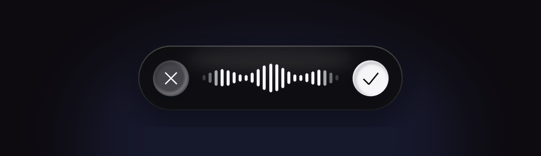
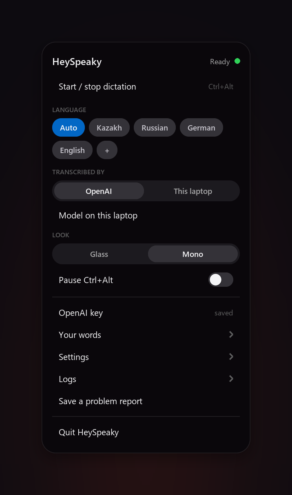
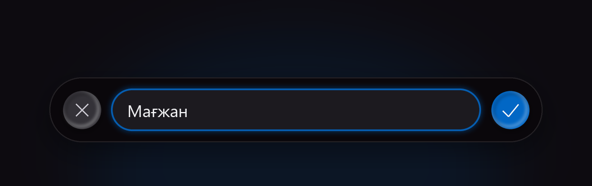

<div align="center">

# HeySpeaky

**Talk in any mix of languages. It types what you said.**

Hold Ctrl+Alt, talk, let go. The text lands in whatever window you were
typing in, even when you switch language halfway through a sentence.
Windows 10 and 11. Free and open source.

[](#install)
[](LICENSE)
[](https://github.com/KoljaB/RealtimeSTT)
[](https://github.com/Maslitsa/HeySpeaky/stargazers)

https://github.com/user-attachments/assets/eb88b19d-8334-41e5-9acf-e3073939af33

<sub>43 seconds, sound on. Every frame of it is drawn in code - see [video/](video).<br>
Voice: Laura, elevenlabs.io. The music is code as well.</sub>

</div>

---

## One sentence, four languages

Said out loud, in one breath:

> I already sent the invoice, aber ich warte noch auf eine Antwort. Но клиент
> до сих пор не ответил, сондықтан ертең қоңырау шаламын.

| | What lands in your window |
| --- | --- |
| **HeySpeaky** | I already sent the invoice, aber ich warte noch auf eine Antwort. Но клиент до сих пор не ответил, сондықтан ертең қоңырау шаламын. |
| Plain Whisper (`whisper-1`) | I already sent the invoice, aber ich warte noch auf eine Antwort. No klient de sikhpor ne atvetil. Sondokhtan Yerchenkhon Raushalam. |

English, German, Russian and Kazakh, each in its own script. Ordinary
dictation picks one language per sentence, so whatever you said in the
others comes back translated, spelled out in the wrong alphabet, or not at
all. HeySpeaky expects you to switch.

## Install

Paste this into PowerShell:

```powershell
irm https://raw.githubusercontent.com/Maslitsa/HeySpeaky/main/install.ps1 | iex
```

It downloads about 1 GB, installs into `%LOCALAPPDATA%\Programs\HeySpeaky`,
starts HeySpeaky with Windows and launches it. Then hold Ctrl+Alt and talk.
Nothing appears in the taskbar or in Alt+Tab: HeySpeaky lives in the tray,
behind the little arrow next to the clock.

### Your OpenAI key (recommended)

OpenAI is much more accurate than the model on your computer, and it is the
one that keeps up when you switch language in the middle of a sentence.
Adding the key:

1. Create a key at
   [platform.openai.com/api-keys](https://platform.openai.com/api-keys) and
   copy it.
2. Click the HeySpeaky icon in the tray, then **Add your OpenAI key**.
3. Paste it into the field with Ctrl+V and press **Save**.

HeySpeaky checks the key with OpenAI, saves it to
`%APPDATA%\HeySpeaky\openai.key` where only your account can read it, and
takes it off the clipboard so it is not left there to be pasted by accident.
The field shows it masked. To change the key later, do the same with the
new one.

It is your own key on your own OpenAI account. Nothing is proxied. Cost is
about $0.006 per minute of audio, roughly $3.60 a month at 20 minutes of
dictation a day. Check [current pricing](https://openai.com/api/pricing/).
Without a key, a Whisper model runs on your own computer instead.

<details>
<summary><b>Giving the key to the installer instead</b></summary>

<br>

Put the key between the quotes and paste the whole line into PowerShell:

```powershell
$env:OPENAI_API_KEY = "PASTE-YOUR-KEY-HERE"; irm https://raw.githubusercontent.com/Maslitsa/HeySpeaky/main/install.ps1 | iex
```

Filled in, it looks like this:

<pre>$env:OPENAI_API_KEY = "<a href="docs/no-key-for-you.md">sk-proj-R4nd0m...x9Qz</a>"; irm https://raw.githubusercontent.com/Maslitsa/HeySpeaky/main/install.ps1 | iex</pre>

The installer does the same checks, and takes the key back out of your
PowerShell history. If you use the plain command, the installer asks which
backend you want and takes the key there instead.

</details>

### Updating, and if it fails

Run the same command again to update. Your settings are kept.

If it fails, the window stays open with the reason, and the whole run is in
`%TEMP%\HeySpeaky-install.log`. If your antivirus blocks the command, use the
ZIP and `INSTALL.bat` described below. If you hit a problem, please
[open an issue](https://github.com/Maslitsa/HeySpeaky/issues) and attach that
log, so I can fix it.

<details>
<summary><b>Options, or a different install location</b></summary>

<br>

To pass arguments, load the script into a script block in PowerShell:

```powershell
$s = [scriptblock]::Create((irm https://raw.githubusercontent.com/Maslitsa/HeySpeaky/main/install.ps1))
& $s -InstallDir 'D:\Apps\HeySpeaky'
& $s -Backend local
& $s -NoAutostart
& $s -NoGame
```

</details>

<details>
<summary><b>Without piping a script from the internet</b></summary>

<br>

Read [install.ps1](install.ps1) first, or skip the pipe:

```powershell
git clone https://github.com/Maslitsa/HeySpeaky.git
cd HeySpeaky
powershell -ExecutionPolicy Bypass -File .\install.ps1
```

If you would rather not use a terminal at all, download the
[ZIP](https://github.com/Maslitsa/HeySpeaky/archive/refs/heads/main.zip), unzip
it somewhere permanent and double-click `INSTALL.bat`.

</details>

## How you use it

| Gesture | What happens |
| --- | --- |
| Hold Ctrl+Alt | Records while held. Let go to transcribe and type it. |
| Tap Ctrl+Alt twice, quickly | Hands-free: it keeps recording with nothing held down. Tap once more to finish, or stop talking and it ends after 2.5 s of silence. |
| Click the tick on the pill | Finishes now. |
| Click the cross on the pill, or press any other key | Cancels. Nothing is typed. |
| Select a word it got wrong, press Ctrl+Alt+Win | Type what you said. It remembers, and gets it right next time. |
| Click the tray icon | Everything else: your languages, your OpenAI key, the look, pause, your words, settings, a problem report. |

The pill never takes focus, so the caret stays exactly where you left it.

## Two looks

<table>
<tr>
<td align="center" width="50%"></td>
<td align="center" width="50%"></td>
</tr>
<tr>
<td align="center"><b>Glass</b><br>Above the taskbar, with a cross to cancel and a tick to finish.</td>
<td align="center"><b>Mono</b><br>Right above your mouse pointer: red while it listens, blue while it thinks, gone when your words land.</td>
</tr>
</table>

Switch in the tray panel under **Look**. The tray panel and the correction
box change with it.

## The tray panel



One click on the tray icon opens it.

- **Your languages.** 97 to choose from. Start typing to find one, in
  English, in Russian, in Kazakh or in its own name. A new install starts
  with the languages your Windows already uses.
- **Transcribed by** OpenAI, or a model on this laptop, which also steps in
  when OpenAI cannot be reached.
- **Model on this laptop**, from Tiny to Large v3 Turbo, downloaded when you
  pick it.
- **Pause Ctrl+Alt** for a game or a call.
- **Your words**: the corrections it has learned.
- **Save a problem report**: a ZIP on your Desktop with your settings and
  the last five recordings, never your key, for when it works worse on one
  PC than another.
- **Quit** asks for a second click, because it is the first thing your
  pointer meets on the way up from the tray.

<br clear="right">

## Teach it your words



Names are what speech recognition gets wrong most. Select the word it
mangled, press **Ctrl+Alt+Win**, type what you said. From then on the word
is named to the model before it listens, and once you have corrected the
same mistake twice it is also fixed in the text afterwards. One correction
is a hint, not a rule, so a real word that happens to sound alike is not
swallowed for good.

Your words stay on your computer, in `%APPDATA%\HeySpeaky\dictionary.json`.

## OpenAI or this laptop

Both measured on the same laptop, a Ryzen 7 7730U with no graphics card,
against the same audio played through speakers into the microphone.

| | OpenAI (recommended) | This laptop |
| --- | --- | --- |
| Model | `gpt-transcribe` | Whisper, `base` unless you pick another |
| Wait after you stop | 1.1 to 2.6 s typical, 7.7 s seen | 1.5 to 1.9 s with `base` |
| English, German | better | good |
| Russian, Kazakh | much better | the weak ones |
| Switching mid-sentence | yes, with no pause | only across a pause |
| Cost | about $0.006 a minute, your own key | free |
| Privacy | audio is sent to OpenAI when you dictate | nothing leaves the computer |
| Offline | no | yes |

Bigger local models hear better and are slower and larger:

| Model | Download | What to expect |
| --- | --- | --- |
| Tiny | 78 MB | fastest, makes the most mistakes |
| Base | 148 MB | fast, the usual choice |
| Small | 486 MB | better, a few seconds a sentence |
| Medium | 1.5 GB | good, slow without a graphics card |
| Large v3 Turbo | 1.6 GB | the best, slow without a graphics card |

## The film

The video at the top is code, not editing: [Remotion](https://www.remotion.dev/)
and [three.js](https://threejs.org/). Speaky is the mono pill with eyes, and
its eight bars move by the same formula the app uses. The narration and the
four-language sentence are a synthesised voice from
[elevenlabs.io](https://elevenlabs.io), the music and the sounds are
written in Python, and what lands in the window is what HeySpeaky really
typed for that sentence, word for word. How to build it, and what is
real and what is not: [video/README.md](video/README.md).

## Something wrong?

Double-click `CHECKUP.bat` in the HeySpeaky folder, or run:

```powershell
cd "$env:LOCALAPPDATA\Programs\HeySpeaky"
.venv\Scripts\python.exe tools\doctor.py
```

It checks the Python version, the dependencies, your settings, the microphone,
the API key, whether HeySpeaky is running and whether it starts with Windows.
Anything it cannot fix gets a line telling you what to do.

If it works worse on someone else's PC, have them dictate a few sentences,
then click the tray icon and **Save a problem report**, and send you the ZIP
from their Desktop.
[docs/troubleshooting.md](docs/troubleshooting.md#it-works-worse-on-another-pc)
says how to read it.

## Uninstall

Paste this into PowerShell:

```powershell
irm https://raw.githubusercontent.com/Maslitsa/HeySpeaky/main/uninstall.ps1 | iex
```

It removes every copy of HeySpeaky on this PC, including old ones called
SpeakIt or VoiceType, with their shortcuts, your saved OpenAI key and the
downloaded speech models. A folder that is a git clone is left where it is.

## Credits

HeySpeaky is built on [RealtimeSTT](https://github.com/KoljaB/RealtimeSTT) by
[Kolja Beigel](https://github.com/KoljaB). RealtimeSTT does the microphone
pipeline and the voice activity detection that ends a hands-free recording,
and none of that is mine. If HeySpeaky is useful to you, star
RealtimeSTT too.

Transcription is the OpenAI API, or
[faster-whisper](https://github.com/SYSTRAN/faster-whisper) running
[OpenAI Whisper](https://github.com/openai/whisper) on your computer.

Full attribution in [NOTICE](NOTICE).

## License

MIT. See [LICENSE](LICENSE).
